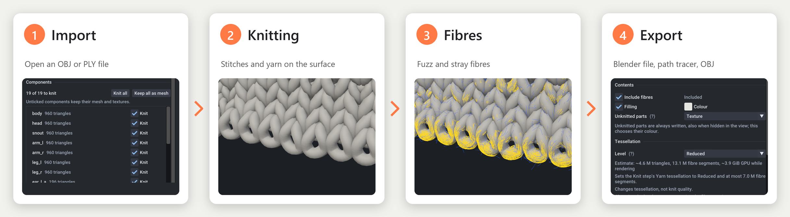
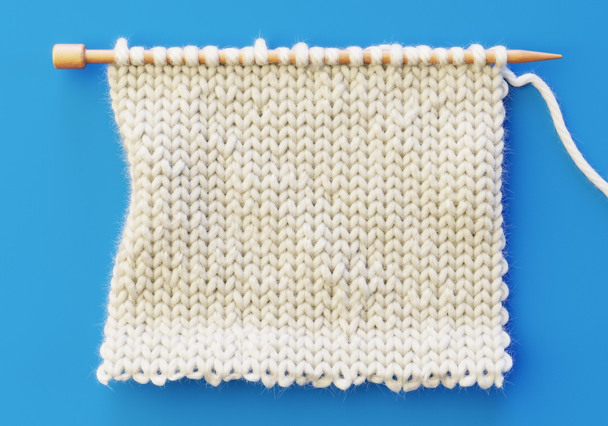

# Wool Shader

Turns ordinary 3D meshes into knitted wool: it generates the yarn, its twisted plies and the fine fibres, ready for rendering.


<sub>Knitting and fibres generated with this tool, rendered with my own spectral path tracer. The bears are based on ["Teddy bears"](https://sketchfab.com/3d-models/teddy-bears-e84b12b4ac20402aaf4d40f2219cd0e2) by [hectopod](https://sketchfab.com/hectopod) ([CC BY 4.0](https://creativecommons.org/licenses/by/4.0/)), modified. Room background: ["Watercolor room interior scene"](https://gum.co/urfLv) by Angelo Ferretti, [Lucy Dreams shop](https://www.lucydreams.it/shop/), used with his permission. The image is shown from the [article](https://nicolasgfx.github.io/woolshader/).</sub>

## Introduction

Rendering wool is tricky: its complex structure has to be modelled, and the way light interacts with its smallest components has to be captured. This brings together several challenges in computer graphics:

- **Modelling:** fibres are spun into plies, plies are twisted into yarn, and the yarn is knitted into interlocking loops that have to be mapped robustly onto any surface. Some fibres follow the ply, others stick out at random.
- **Rendering:** wool fibres are dielectric. Light reflects off a fibre or enters it, where it is absorbed or reflected internally before leaving again. Fibre thickness, tapering and absorption decide how plausible the result looks.
- **GPU memory:** tens of millions of fibre segments fill much of a consumer GPU's memory. Baking the yarn's fibre detail into texture maps and keeping only the loose fuzz as geometry reduces that cost.

The full write-up is the [article](https://nicolasgfx.github.io/woolshader/). More renders are in my [rendering portfolio](https://github.com/nicolasgfx/Portfolio).

## What this delivers

- A guided workflow that combines existing approaches to generate detailed knitted wool and export it ready for rendering.
- A structured look at wool from a computer graphics perspective: its components, its fibres and how they interact with light.
- Practical settings for modelling and rendering different wool types.
- Rendering experiments that make the wool look convincing within the limits of a consumer GPU.



The app has guided steps, each building on the previous one: **Import** an `.obj` or `.ply` mesh, optionally **Mark** it for the experimental stitch-mesh route, generate the **Knitting**, optionally add **Fibres**, and **Export**. Presets give a starting point for different wool types; every setting can still be fine-tuned. Exports are a Blender file, Wavefront OBJ, or a scene for my renderer, `photon_path_tracer`.

The repository ships one example model, the wool swatch on a needle (`scenes/wool-swatch`), in a cream and a blue version. The teddy bears are registered as examples too, but their model is not distributed; the Import step offers only the examples whose model is present.

A ready-to-render Blender scene of the cream swatch, made with the Wool Shader, is part of this repository's releases: [wool_swatch_white.blend](https://github.com/nicolasgfx/woolshader/releases/download/swatch-scene-2026-11/wool_swatch_white.blend) (Blender 5.1, 459 MB, CC BY-NC 4.0; release [swatch-scene-2026-11](https://github.com/nicolasgfx/woolshader/releases/tag/swatch-scene-2026-11) with its notice and checksums).

## Compared with a real photograph

<table>
  <tr>
    <td></td>
    <td></td>
  </tr>
  <tr>
    <td align="center">My render</td>
    <td align="center">Photograph by Kristen McDonnell of Studio Knit</td>
  </tr>
</table>

Reference photograph: **Kristen McDonnell of [Studio Knit](https://www.studioknitsf.com/)**, from her [Stockinette Stitch tutorial](https://www.studioknitsf.com/knitting-lessons-stockinette-stitch/), reproduced unaltered with permission and shown from the [article](https://nicolasgfx.github.io/woolshader/). My render is separate work; she has not endorsed or verified it.

## Documentation

The [article](https://nicolasgfx.github.io/woolshader/) explains how the knitting, fibres and rendering work, with settings and results, and lists every paper used and which part of each. The knitting approach draws on [Stitch Meshes for Modeling Knitted Clothing with Yarn-Level Detail](https://www.cemyuksel.com/research/stitchmeshes/) (Yuksel, Kaldor, James and Marschner, 2012). The source's structure is described in [src/ARCHITECTURE.md](src/ARCHITECTURE.md); [CONTRIBUTING.md](CONTRIBUTING.md) and [STYLE.md](STYLE.md) say how to change it.

## Prerequisites and build

The build scripts target Windows. You need:

- Visual Studio 2022 or its Build Tools, with the C++ toolset and CMake/Ninja tools.
- An NVIDIA GPU and the CUDA Toolkit. The build looks for CUDA 13.4 in its standard location; set `KNIT_CUDA_ROOT` for another one. The default GPU architecture is `89` (RTX 40 series); set `KNIT_CUDA_ARCH` in CMake for another.
- Git and an internet connection for the dependencies fetched during the first configuration.

Clone the source only (the repository's `gh-pages` branch holds the article's site, about 330 MB of images):

```powershell
git clone --single-branch https://github.com/nicolasgfx/woolshader.git
```

From PowerShell in the project directory, build and launch the viewer:

```powershell
.\build.bat run
```

The build lives next to the checkout, in `..\<checkout>-build\release`, where you can launch `knit_viewer.exe` (`run.bat` builds and starts it). `KNIT_BUILD_DIR` chooses another folder; `.\build.bat test` runs the tests.

Optional, through environment variables:

- `KNIT_PPT_EXE`: the `ppt.exe` of `photon_path_tracer`, for the viewer's Render preview and the tests that load an exported scene (they skip without it).
- `KNIT_BLENDER`: the `blender.exe` (5.1 or later) for the Blender file export, if it is not found by itself.
- `KNIT_FUR=1`: switches on the Fur workflow, which is not released yet.

## Credits and licence

The source code is released under the [MIT License](LICENSE), except:

- `blender/ppt_package_to_blend.py`, released under [GPL-3.0-or-later](blender/LICENSE) because it uses Blender's Python API. The application only starts Blender as a separate program for the Blender export and works without it.
- `third_party/slim/src`, eight files of the SLIM solver from Blender's `intern/slim`, under the [Mozilla Public License 2.0](third_party/slim/LICENSE) ([third_party/slim/README.md](third_party/slim/README.md)).

The wool swatch model (`scenes/wool-swatch`) is licensed under CC BY-NC 4.0 ([its licence](scenes/wool-swatch/LICENSE.md)). The images in `media/` and the images shown from the article are not covered by the MIT License; see [media/LICENSE.md](media/LICENSE.md). In particular:

- **Watercolor room.** The room behind the bears is the ["Watercolor room interior scene"](https://gum.co/urfLv) by Angelo Ferretti ([Lucy Dreams](https://www.lucydreams.it/shop/)), bought under the [Lucy Dreams EULA](https://www.lucydreams.it/shop/eula-license/) and used with his written permission. The scene's files are not part of this repository, and Angelo Ferretti and Lucy Dreams do not endorse this project.
- **Teddy bears.** The bears are based on ["Teddy bears"](https://sketchfab.com/3d-models/teddy-bears-e84b12b4ac20402aaf4d40f2219cd0e2) by [hectopod](https://sketchfab.com/hectopod), licensed under [CC BY 4.0](https://creativecommons.org/licenses/by/4.0/). The knitting and fibres were generated by this tool, and materials were added. The model is not part of this repository.
- **Swatch photograph.** The reference photograph is by Kristen McDonnell of [Studio Knit](https://www.studioknitsf.com/), from her [Stockinette Stitch tutorial](https://www.studioknitsf.com/knitting-lessons-stockinette-stitch/). It is reproduced unaltered with her permission, remains her work and is not a file of this repository. Her permission does not constitute endorsement of this project and grants readers no reuse licence.

The build downloads [cgltf](https://github.com/jkuhlmann/cgltf) (MIT), [stb](https://github.com/nothings/stb) (MIT or public domain), [OpenVDB](https://github.com/AcademySoftwareFoundation/openvdb) and [oneTBB](https://github.com/uxlfoundation/oneTBB) (Apache-2.0), [Eigen](https://gitlab.com/libeigen/eigen) (MPL-2.0), [RIM](https://github.com/gaoxifeng/robust_hex_dominant_meshing) (MIT, with parts of Instant Meshes under BSD), [pcg32](https://github.com/wjakob/pcg32) (Apache-2.0), [HiGHS](https://github.com/ERGO-Code/HiGHS) (MIT), [Dear ImGui](https://github.com/ocornut/imgui) (MIT) and [GLFW](https://github.com/glfw/glfw) (zlib), which are not included in this repository; [third_party/README.md](third_party/README.md) lists the pinned versions. The viewer's About window shows every licence text. The GPU build links against the NVIDIA CUDA Toolkit, installed separately under NVIDIA's licence terms.
